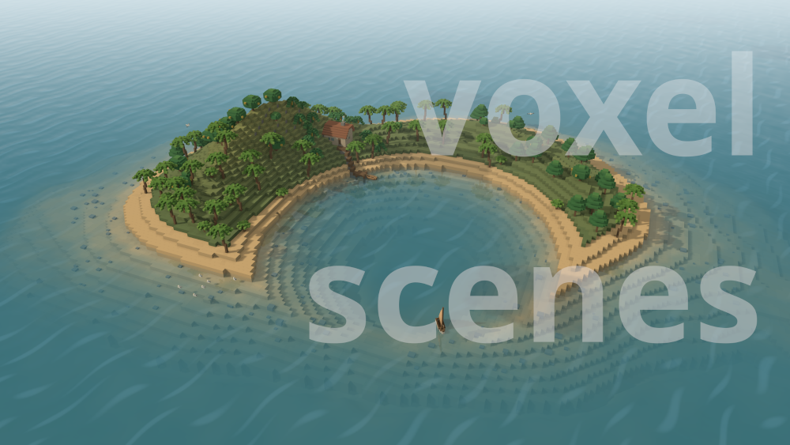

Generate a cosy voxel landscape in the browser and save it as a desktop wallpaper.
Choose Crescent bay, Woodland stream, Hillside falls or Orchard millpond.
[Open the generator](https://www.wilfred.me.uk/voxel-scenes/) or
[rotate the models in the asset library](https://www.wilfred.me.uk/voxel-scenes/assets.html).

## Running the generator

With Node.js 22.12 or newer installed, run `npm ci` and `npm run dev -- --port 5173 --strictPort`,
then open the local URL printed by Vite. Choose a scene and generate a landscape.
Vista framing looks across the land in perspective toward a hazy horizon.
Rectangular model framing shows the whole place as a miniature block. Save PNG
exports at the size chosen beside it, which defaults to this screen's resolution
and always offers 2560 × 1600. The preview takes the same shape.

Run `npm run build` to type-check the TypeScript and create the static site
in `dist/`. Run `npm run preview` to serve that build locally. Run
`npm run check` to generate every scene across a sweep of seeds and check
that each builds and that its paths climb at most one terrain layer per step.

Grid resolution controls how many terrain cells fit across the wallpaper.
The range is 0.75× to 5× in quarter steps. At 5×, five times as many cells fit
across the wallpaper. The export size stays the same.
Each landscape draws from four cottages, four pines, four broadleaves and three
palms using its seed, so
every design appears across the days. The asset library shows them all, each
tree with its adult and sapling. Scroll over the preview or use the − and +
buttons to zoom from 50% to 300%. Click Reset camera, double-click the preview,
or press Home while the preview has focus to restore the opening view.
The controls fade after a few idle seconds and return when you move. Press Space
to toggle them at any time. Hiding them with Space or × keeps them out of the
way for a minute while you move around.

The opening seed comes from the local calendar date. Reload to revisit today's
landscape, or use the New button in the top bar for a random seed. The `scene`,
`framing`, `light`, `seed` and `size` URL parameters open a particular composition,
for example `?scene=woods&framing=model&light=morning&seed=123&size=2560x1600`. In Orchard millpond, follow
the headrace past the waterwheel to the duck pond and the cart track to the
orchard stall. The orchard blossoms in April and May, and a small wreath hangs
on the mill door in December.

Four short voxel rays estimate contact shade around opaque surfaces. Larger
landscapes use coarser tracing cells. Three.js Reflector captures the landscape
for flat water, with the sky filling the gaps. The falling faces of the
waterfall scatter the reflected sky. Shallow water shows the bed through it.
Direct sunlight uses shadow maps.

## Updating your wallpaper on macOS

With Google Chrome installed on your Mac, run `npm ci` once from this checkout.

Run `npm run wallpaper:mac` whenever you want to apply today's wallpaper.
The script opens the published generator in headless Google Chrome, saves a
2560 × 1600 PNG under `~/Pictures/Voxel Scenes`, and applies it to the connected
displays in your macOS desktop session. To choose a scene, framing or
lighting stop, pass a quoted generator URL:

```sh
npm run wallpaper:mac -- 'https://www.wilfred.me.uk/voxel-scenes/?scene=woods&framing=model&light=auto'
```

The script uses the Mac's local calendar date for the seed and picks lighting
from the local hour on each run. Sunrise is before 08:00, Morning is 08:00–10:59,
Midday is 11:00–14:59, Evening is 15:00–17:59, and Sunset is from 18:00. Set
`light=sunrise`, `morning`, `midday`, `evening` or `sunset` in the URL to pin a stop.

## Lighting

The Lighting slider moves through five stops from Sunrise to Sunset while keeping
the scene and camera in place. The browser opens at Midday by default. Use
`light=auto` in a browser URL to pick a stop from the local hour on load.
Vista skies and water reflections share a cloud map. Rectangular models keep
their plain backdrop.

Compare the woodland bridge at seed 123 at [sunrise](https://www.wilfred.me.uk/voxel-scenes/?scene=woods&framing=vista&light=sunrise&seed=123)
and [sunset](https://www.wilfred.me.uk/voxel-scenes/?scene=woods&framing=vista&light=sunset&seed=123).
